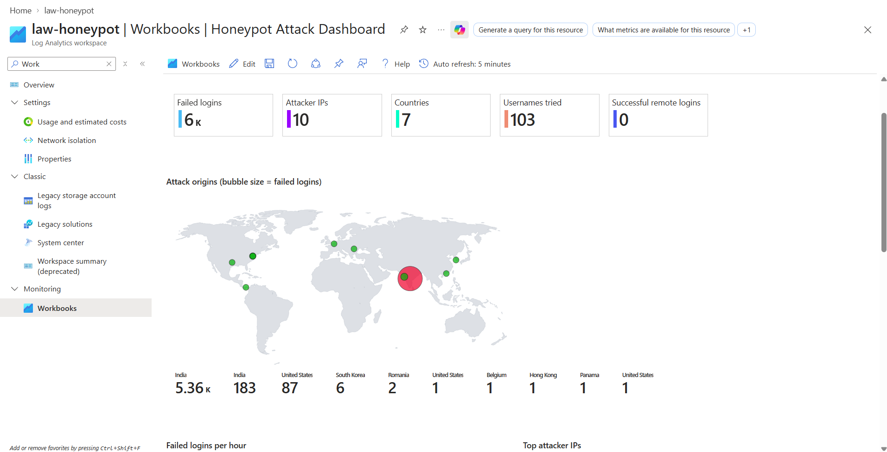
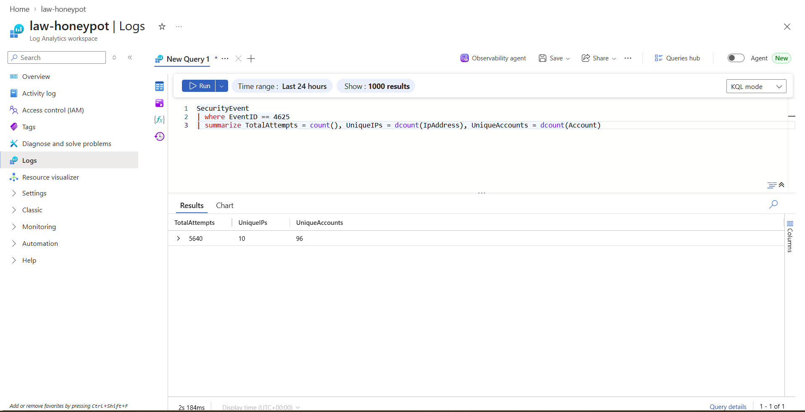
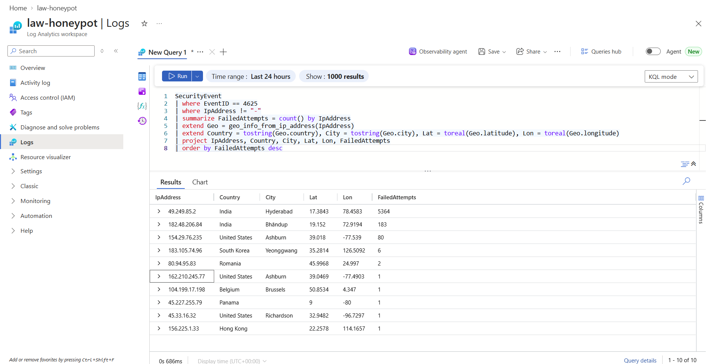
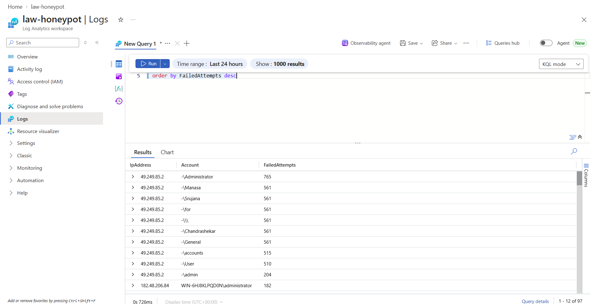

# Azure Honeypot + Microsoft Sentinel SIEM

## Overview
Deployed an intentionally exposed Windows Server VM in Azure to attract real-world brute-force attacks. Security logs were forwarded to a Log Analytics workspace with Microsoft Sentinel through the Azure Monitor Agent, and attacker IPs were geolocated with KQL. I built the detection queries and a live attack-map workbook, then wrote up the main brute-force campaign as an incident using the NIST SP 800-61 phases.

Within 24 hours of going live, the VM logged **5,640 failed logons from 10 IPs in 7 countries**. **None of them got in.**



## Architecture
```
Internet ──► NSG (Any/Any allowed) ──► vm-honeypot (Windows Server 2022, firewall off)
                                              │
                                     Azure Monitor Agent
                                              │
                                Data Collection Rule (dcr-honeypot)
                                   All Security Events → SecurityEvent
                                              │
                               Log Analytics workspace (law-honeypot)
                                              │
                    Microsoft Sentinel · KQL queries · Attack dashboard workbook
```

| Component | Setting |
|---|---|
| Region | South Central US |
| VM | `vm-honeypot`, Windows Server 2022 Datacenter, D2als_v6 |
| Exposure | NSG rule `DANGER_AllowAnyInbound` (priority 100), Windows Defender Firewall off |
| Log pipeline | AzureMonitorWindowsAgent → `dcr-honeypot` → `law-honeypot` |
| SIEM | Microsoft Sentinel with the Windows Security Events solution (installed from Content hub in the Defender portal) |

## Tools & Technologies
- Microsoft Azure: VM, NSG, Log Analytics, Azure Monitor Agent, Data Collection Rules
- Microsoft Sentinel (SIEM) and Azure Workbooks
- KQL (Kusto Query Language)
- GeoIP enrichment with the built-in `geo_info_from_ip_address()` function
- NIST SP 800-61 incident response

## Results: first 24 hours (Sept 28–29, 2026)
| Metric | Value |
|---|---|
| Total failed logons (Event ID 4625) | **5,640** |
| Unique attacking IPs | **10** |
| Countries of origin | **7** (India, US, South Korea, Romania, Belgium, Panama, Hong Kong) |
| Unique usernames tried | **96** |
| Successful external logons | **0** |
| Top attacker | `49.249.85.2` (Hyderabad, India), 5,364 attempts (~95%) |
| Cost after day 1 | $1.05, paid from Azure free-trial credit ($0 out of pocket) |



### Attackers by IP
| IP | Location | Failed logons |
|---|---|---|
| 49.249.85.2 | Hyderabad, India | 5,364 |
| 182.48.206.84 | Bhandup, India | 183 |
| 154.29.76.235 | Ashburn, US | 80 |
| 183.105.74.96 | Yeonggwang, South Korea | 6 |
| 80.94.95.83 | Romania | 2 |
| 162.210.245.77 | Ashburn, US | 1 |
| 104.199.17.198 | Brussels, Belgium | 1 |
| 45.227.255.79 | Panama | 1 |
| 45.33.16.32 | Richardson, US | 1 |
| 156.225.1.33 | Hong Kong | 1 |



### Top attempted usernames
| Username | Attempts |
|---|---|
| Administrator | 765 |
| Manasa | 561 |
| Srujana | 561 |
| Chandrashekar | 561 |
| General | 561 |
| accounts | 515 |
| User | 510 |
| admin | 204 |

Several usernames received exactly 561 attempts each. That points to an automated tool working through a fixed username list with the same password list for every name (credential spraying), not a person guessing.



## Detections
All queries are in [`kql/`](kql/):

| Query | Purpose |
|---|---|
| [`securityevent-check.kql`](kql/securityevent-check.kql) | Confirm logs are flowing from the VM |
| [`failed-logons.kql`](kql/failed-logons.kql) | Failed logons (4625) by IP and username |
| [`summary-metrics.kql`](kql/summary-metrics.kql) | Headline counts: attempts, unique IPs, unique usernames |
| [`geoip-failed-logons.kql`](kql/geoip-failed-logons.kql) | Failed logons per IP with country, city, lat/long |
| [`successful-external-logons.kql`](kql/successful-external-logons.kql) | Successful logons (4624) from outside IPs, which should be empty |

## Incident Response
[`incidents/incident-01-rdp-brute-force-49.249.85.2.md`](incidents/incident-01-rdp-brute-force-49.249.85.2.md) is a NIST 800-61 write-up of the main brute-force campaign. It also covers a follow-up review of anonymous NTLM logons seen a few days later.

## Build evidence
| Step | Screenshot |
|---|---|
| NSG left wide open | [01](screenshots/01-nsg-danger-allow-any-inbound.png) |
| Windows Firewall turned off inside the VM | [02](screenshots/02-vm-windows-firewall-off.png) |
| Exposure confirmed with ping from outside | [03](screenshots/03-ping-honeypot-exposed.png) |
| No successful external logons | [05](screenshots/05-no-successful-external-logons.png) |
| Cost after day 1 | [09](screenshots/09-azure-cost-day1.png) |
| Anonymous NTLM logon review | [10](screenshots/10-anonymous-ntlm-logons.png) |

Full step-by-step notes are in [`docs/build-log.md`](docs/build-log.md).

## Problems & Fixes
- **B-series VM sizes weren't available** on the free-trial subscription (`NotAvailableForSubscription`). I switched to D2als_v6.
- **The Sentinel Content hub had moved** to the Defender portal (security.microsoft.com). I installed the Windows Security Events solution from there.
- **A duplicate Data Collection Rule** showed up during setup. I kept `dcr-honeypot` as the active rule.
- **The Domain firewall profile was still on** inside the VM after I turned off Private and Public.
- **No GeoIP watchlist needed.** KQL's built-in `geo_info_from_ip_address()` does the lookup.

## Lessons Learned
- An exposed RDP port gets found and attacked within hours, not days.
- Most of the volume came from a single IP spraying a username list. Rate limiting or blocking a handful of IPs would remove ~95% of the noise.
- Failed logons are expected noise. The query that matters is **successful logons from outside**, so that one is worth alerting on.
- "Successful" logon events need context. The `ANONYMOUS LOGON` NTLM events seen later were unauthenticated null sessions, not a compromise (see the incident write-up).
- In production, RDP should never face the internet. Use Azure Bastion or a VPN, restrict the NSG to known IPs, and turn on account lockout and MFA.

## Status & Teardown
The honeypot ran from **Sept 28, 2026** until the Azure free-trial credit expired (**Oct 27, 2026**). After that the subscription stopped, so the VM collected no more data. Log Analytics data aged out under the default retention, so the live dashboard is now empty. The screenshots above are the record of the results.

Planned next steps if rebuilt: a hardening phase (NSG locked to my IP, firewall back on) to measure before/after, Sentinel analytics rules that create incidents automatically, and longer data retention.
